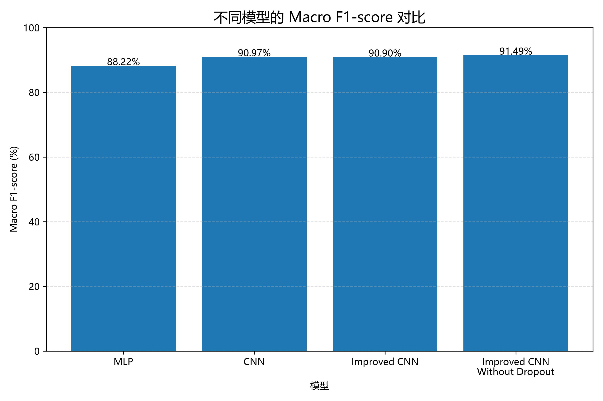
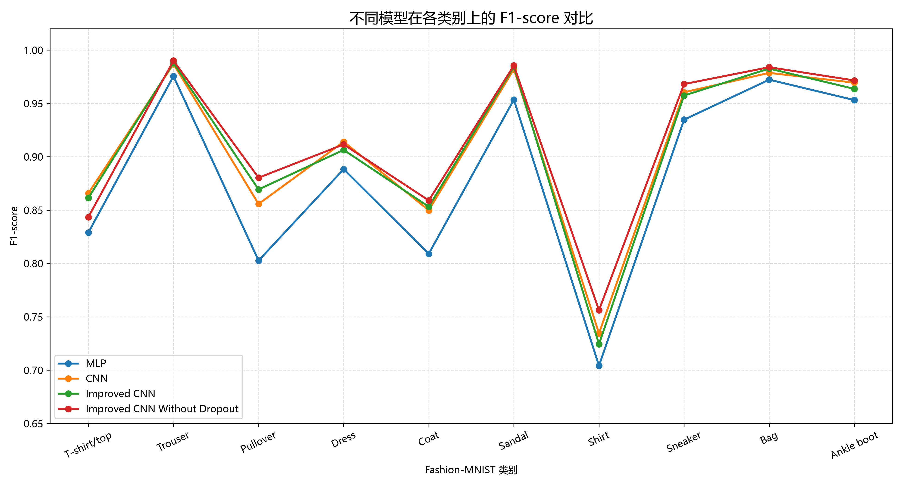
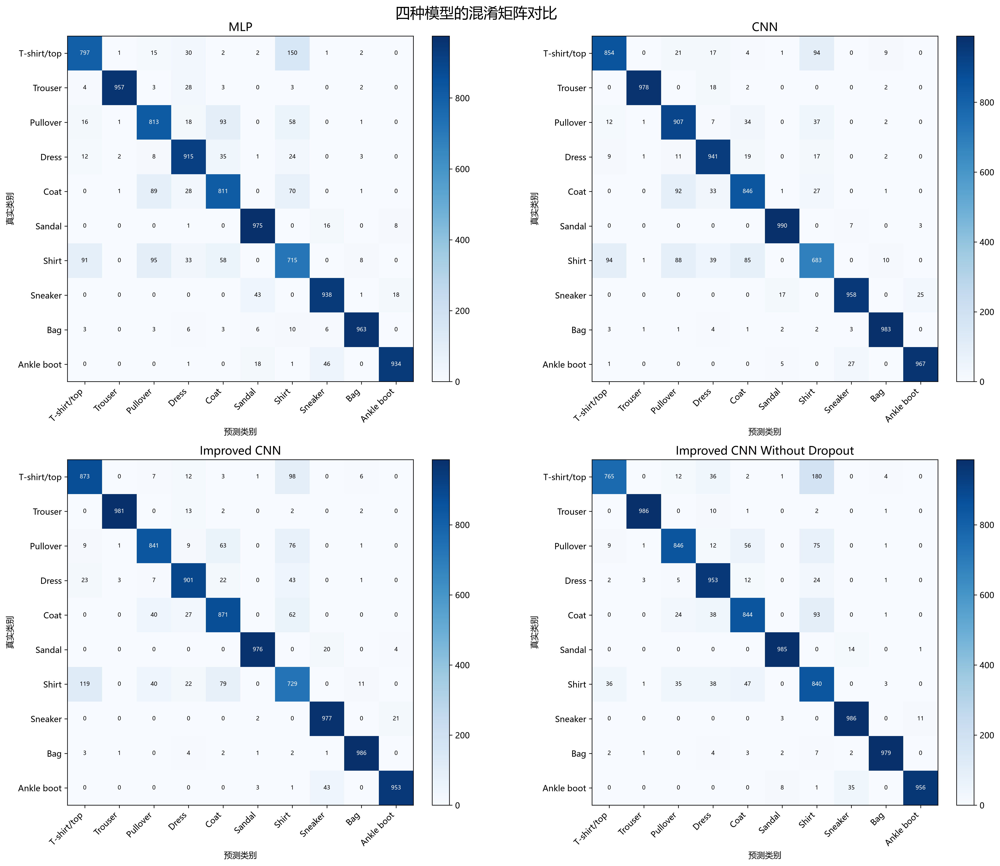
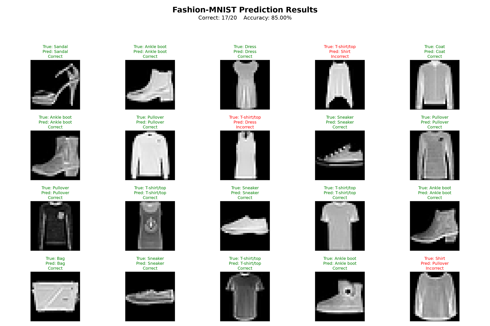
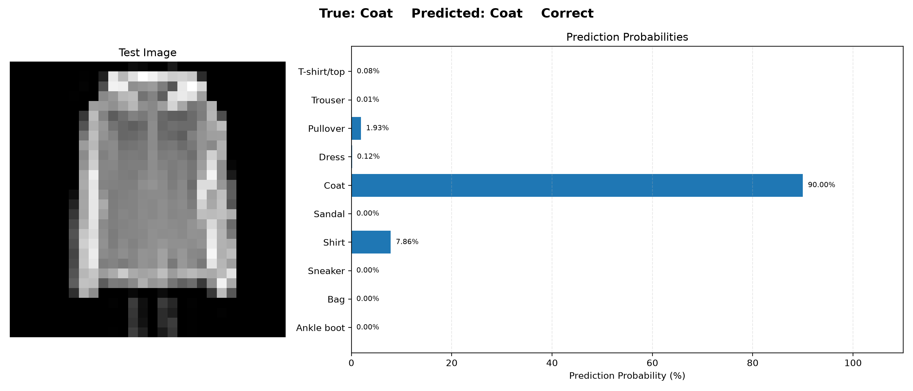
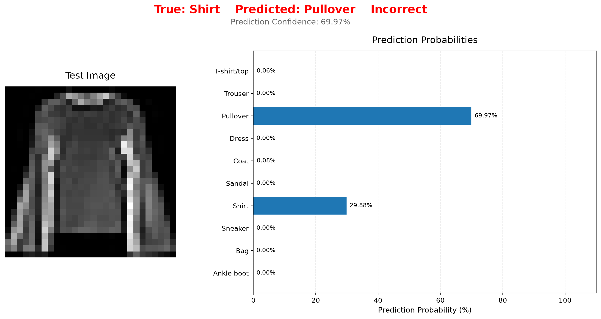

# FashionVision-MindSpore

**基于 MindSpore 的 Fashion-MNIST 图像分类项目**

本项目使用 Python 和 MindSpore 深度学习框架，在 Fashion-MNIST 数据集上实现服饰图像分类。通过构建多层感知机（MLP）、基础卷积神经网络（CNN）和改进型 CNN，对比不同网络结构的分类效果，并进一步通过消融实验分析 Dropout 对模型性能的影响。

项目包含数据集读取与预处理、模型构建、模型训练、模型评估、
实验结果可视化和批量图片预测等环节。

在预测部分，项目支持对完整测试集进行推理，
并通过预测网格、类别概率柱状图和错误案例可视化展示模型的分类结果。

## 一、项目介绍

Fashion-MNIST 是一个常用的图像分类数据集，包含 10 种不同类别的服饰灰度图像。

本项目主要围绕以下问题展开：

- 全连接神经网络与卷积神经网络在图像分类任务中的表现有什么区别？
- 在基础 CNN 上增加卷积层和 Batch Normalization，能否改善分类效果？
- Dropout 是否一定能够提升模型的泛化性能？

通过设计不同模型并进行实验对比，观察网络结构变化对分类结果的影响。

本项目的一个重点是围绕 Dropout 设计消融实验，在保持改进 CNN 主要结构不变的情况下，对比使用和移除 Dropout 两种设置下的分类表现，并结合整体评价指标与类别混淆情况分析实验结果。

## 二、数据集介绍

本项目使用 Fashion-MNIST 数据集。

| 数据集信息 | 内容 |
|---|---|
| 训练集 | 60,000 张图像 |
| 测试集 | 10,000 张图像 |
| 图像尺寸 | 28 × 28 |
| 图像通道 | 单通道灰度图 |
| 分类类别 | 10 类 |

类别包括：

T-shirt/top、Trouser、Pullover、Dress、Coat、Sandal、Shirt、Sneaker、Bag、Ankle boot。

数据集来源：[Fashion-MNIST 官方仓库](https://github.com/zalandoresearch/fashion-mnist)。

### 数据预处理

项目使用 MindSpore Dataset 加载数据，并完成以下预处理：

1. 使用 `Rescale` 将像素值缩放至 0～1。
2. 使用 `Normalize` 对图像进行标准化，均值为 0.2860，标准差为 0.3530。
3. 使用 `HWC2CHW` 将图像维度转换为适合网络输入的格式。
4. 将标签转换为 `int32` 类型。
5. 使用 Batch 操作将数据划分为批次，Batch Size 设置为 64。

## 三、技术栈

- Python 3.11.9
- MindSpore 2.10.0
- NumPy 1.26.4
- Matplotlib 3.11.2
- Scikit-learn 1.9.1
- Pillow 13.0.0
- PyCharm
- Git / GitHub

## 四、模型设计

项目实现并比较了四种模型。

### 1. 多层感知机（MLP）

将输入的 28 × 28 图像展平为 784 维向量，通过三层全连接结构完成分类：

`784 → 256 → 128 → 10`

该模型作为基础对照模型，用于观察不使用卷积操作时的分类效果。

参数量：235,146。

### 2. 基础卷积神经网络（CNN）

使用两组卷积层和最大池化层提取图像特征，再通过全连接层输出分类结果。

主要结构：

- Conv2d：1 → 16
- Conv2d：16 → 32
- MaxPool2d
- Flatten
- Fully Connected：1568 → 128 → 10

参数量：206,922。

### 3. 改进卷积神经网络（Improved CNN）

在基础 CNN 的基础上增加卷积层和 Batch Normalization，并引入 Dropout。

主要改进：

- 增加卷积通道数；
- 使用 Batch Normalization 稳定训练过程；
- 使用 Dropout 降低过拟合风险。

参数量：431,146。

### 4. 去除 Dropout 的改进卷积神经网络（Improved CNN Without Dropout）

保持改进 CNN 的主要网络结构不变，移除 Dropout 层，观察模型性能变化。

该模型用于 Dropout 消融实验，分析正则化方法在当前实验设置下的实际效果。

参数量：431,146。

## 五、实验设置

为保证模型之间具有可比性，实验采用相同的主要训练配置：

| 实验配置 | 设置 |
|---|---|
| 数据集 | Fashion-MNIST |
| 运行设备 | CPU |
| Batch Size | 64 |
| Epochs | 5 |
| 优化器 | Adam |
| Learning Rate | 0.001 |
| Loss Function | CrossEntropyLoss |
| 评价数据 | 测试集 |

评价指标包括：

- Accuracy：准确率
- Precision：精确率
- Recall：召回率
- F1-score：F1 分数
- Confusion Matrix：混淆矩阵

## 六、实验结果与分析

### 1. 不同模型整体性能对比

**实验结果说明：**

以下结果为本项目最终采用的实验记录，来自此前完成的四种模型训练与测试评估。所有模型均采用相同的主要训练配置：Batch Size=64、Epochs=5、Adam 优化器、Learning Rate=0.001。

由于神经网络训练存在随机性，重新训练时可能受到随机初始化、数据打乱顺序等因素影响，因此重新运行项目不保证得到完全一致的结果。

本项目将上述实验数据作为最终结果展示。后续使用者可以根据项目代码重新训练模型，独立获得新的实验结果。

| 模型 | Accuracy | Macro F1 |
|---|---:|---:|
| MLP | 88.18% | 88.22% |
| CNN | 91.07% | 90.97% |
| Improved CNN | 90.88% | 90.90% |
| Improved CNN Without Dropout | **91.40%** | **91.49%** |

从实验结果可以看出：

- CNN 相比 MLP 在准确率上提高了 2.89 个百分点，说明卷积操作能够更好地提取图像的局部特征。
- Improved CNN 并没有在本次实验中超过基础 CNN，说明增加网络结构复杂度并不一定能够带来性能提升。
- 去除 Dropout 后，模型取得了本次实验中最高的 Accuracy 和 Macro F1。

### 2. Accuracy 对比


### 3. Macro F1 对比



### 4. 各类别 F1-score 对比



### 5. 混淆矩阵对比



### 6. Dropout 消融实验分析

在保持改进 CNN 主要结构不变的情况下，分别训练带有 Dropout 和不带 Dropout 的模型。

实验结果：

| 指标 | Improved CNN | Without Dropout |
|---|---:|---:|
| Accuracy | 90.88% | 91.40% |
| Macro F1 | 90.90% | 91.49% |

在本次实验设置下，去除 Dropout 后，Accuracy 提高了 0.52 个百分点，Macro F1 提高了 0.59 个百分点。

进一步观察分类结果可以发现，不同类别的表现并不完全一致。例如，去除 Dropout 后，模型对 Shirt 类别的识别效果有所改善，但 T-shirt/top 被误判为 Shirt 的情况也有所增加。

这说明模型整体指标的提升并不意味着所有类别都获得了同等程度的改善。

需要注意的是，目前每种模型只进行了单次训练，实验轮数也相对有限，因此不能据此得出 Dropout 在一般情况下无效的结论。实验结果仅反映当前数据集、模型结构和训练配置下的表现。

## 七、模型预测与结果可视化

项目使用训练完成的 Improved CNN Without Dropout 模型，
对 Fashion-MNIST 完整测试集进行批量预测。

程序首先加载训练好的模型权重，
然后对测试集中的图像进行前向推理，
通过 Softmax 将模型输出转换为各类别的预测概率。

预测完成后，程序统计完整测试集的预测正确数量、
预测错误数量和准确率，并生成以下三种可视化结果。

### 1. 批量预测结果

随机选取测试集中的20张图片，
展示每张图片的真实类别、预测类别以及预测是否正确。



### 2. 单张图片预测概率

选取一张预测正确的测试图片，
展示原始图像以及模型对10个类别的预测概率。



### 3. 错误案例分析

从测试集中选取一张预测错误的图片，
展示其真实类别、预测类别和各类别预测概率，
用于观察模型可能存在的分类困难。



以上图片均由 `src/predict.py` 自动生成，
保存在 `results/` 目录下。


## 八、项目结构

```text
FashionVision-MindSpore/
│
├── data/
│   └── fashion_mnist/       # 本地数据集（不上传 GitHub）
│
├── checkpoints/             # 模型权重（不上传 GitHub）
│
├── results/                 # 实验结果与可视化图片
│   ├── accuracy_comparison.png
    ├── macro_f1_comparison.png
    ├── class_f1_comparison.png
    ├── confusion_matrix_comparison.png
    ├── prediction_grid.png
    ├── prediction_probability.png
    └── prediction_error.png
│
├── src/
│   ├── dataset.py            # 数据集加载与预处理
│   ├── models.py             # 神经网络模型定义
│   ├── train.py              # 模型训练
│   ├── evaluate.py           # 模型评估
│   ├── visualize.py          # 实验结果可视化
│   └── predict.py            # 单张图片预测
│
├── .gitignore
├── requirements.txt
├── README.md
└── main.py                  # 项目入口，展示项目基本信息与功能概览
```

## 九、运行方法

本项目支持从零开始配置运行环境、下载数据集、训练模型、评估模型以及生成实验可视化结果。

需要注意的是，项目中的四模型对比图使用的是此前保存的实验记录，而当前 GitHub 版本的训练和评估脚本默认针对 Improved CNN Without Dropout 模型。

### 1. 克隆项目

```bash
git clone https://github.com/yyty718/FashionVision-MindSpore.git
cd FashionVision-MindSpore
```

### 2. 查看项目信息

在项目根目录下运行：

```powershell
python main.py
```

运行后，终端会显示项目基本信息和已实现的主要功能。

`main.py` 主要用于展示项目基本信息和功能概览，不会自动执行训练、评估或预测。

### 3. 创建虚拟环境

```bash
python -m venv .venv
```

Windows PowerShell 激活环境：

```powershell
.\.venv\Scripts\Activate.ps1
```

### 4. 安装依赖

```bash
pip install -r requirements.txt
```

注意：MindSpore 的安装需要结合操作系统、Python 版本和运行设备选择合适的安装环境。

本项目使用 Python 3.11.9 和 MindSpore 2.10.0，在 CPU 环境下完成实验。

### 5. 下载数据集

项目提供了数据集自动下载函数。

在项目根目录下执行：

```powershell
python -c "import sys; sys.path.insert(0, 'src'); from dataset import download_data; download_data()"
```

数据将下载并解压至：

```text
data/fashion_mnist/
```

### 6. 训练模型

在项目根目录下运行：

```powershell
python src/train.py
```

当前训练脚本默认训练 Improved CNN Without Dropout 模型。

主要训练配置：

- Batch Size：64
- Epochs：5
- Optimizer：Adam
- Learning Rate：0.001
- Loss Function：CrossEntropyLoss

训练完成后，模型参数将保存至：

```text
checkpoints/improved_cnn_no_dropout.ckpt
```

注意：当前版本的训练入口默认只训练 Improved CNN Without Dropout，不会自动训练全部四种模型。

### 7. 模型评估

完成模型训练后，运行：

```powershell
python src/evaluate.py
```

程序将加载训练得到的模型权重，并在 Fashion-MNIST 测试集上计算 Accuracy，输出各类别的 Precision、Recall、F1-score 和 Confusion Matrix。

需要先完成模型训练，确保对应的模型权重文件存在。

### 8. 生成实验对比图

在项目根目录下运行：

```powershell
python src/visualize.py
```

程序将生成以下四张图表：

- `accuracy_comparison.png`：四种模型的 Accuracy 对比；
- `macro_f1_comparison.png`：四种模型的 Macro F1 对比；
- `class_f1_comparison.png`：四种模型在不同类别上的 F1-score 对比；
- `confusion_matrix_comparison.png`：四种模型的混淆矩阵对比。

生成的图片保存在 `results/` 目录下。

注意：当前版本的可视化脚本使用项目此前保存的四模型实验数据，不会自动读取重新训练后的评估结果。因此，重新训练模型不会自动更新四模型对比图。

### 9. 单张图片预测

完成模型训练后，运行：

```powershell
python src/predict.py
```

程序将加载 Improved CNN Without Dropout 模型，对 Fashion-MNIST 测试集中的第一张图片进行预测。

运行结果包括真实类别、预测类别和各类别预测概率，并生成：

```text
results/prediction_result.png
```

### 10. 实验结果复现说明

本项目 GitHub 仓库未上传 Fashion-MNIST 数据集和模型权重文件，需要使用者自行下载数据集并训练模型。

README 中展示的四模型实验结果来自此前完成的训练与评估记录。当前仓库保留了对应的实验结果可视化代码，但没有上传当时四种模型的权重文件。

使用者可以按照上述步骤重新训练 Improved CNN Without Dropout，并完成模型评估和单张图片预测。

由于神经网络训练存在随机性，重新训练得到的指标可能与 README 中记录的实验结果存在差异。本项目不保证重新运行后能够完全复现表格中的数值。

## 十、项目总结与后续改进

通过本项目，完成了基于 MindSpore 的图像分类基本流程，实践了数据预处理、神经网络构建、模型训练、模型评估和实验可视化等环节。

实验表明，模型结构的复杂程度并不能直接决定分类效果。不同网络结构、正则化方法和训练配置都可能影响模型的最终表现，需要通过实验进行验证。

后续可以从以下方向继续改进：

- 增加随机种子控制和多次重复实验，提高结果的稳定性；
- 引入验证集，进一步观察模型的泛化能力；
- 尝试调整学习率、Batch Size 和训练轮数；
- 增加错误分类样本分析和特征图可视化；
- 扩展单张图片预测功能，支持用户输入自己的服饰图片。

---

**项目地址：** [FashionVision-MindSpore](https://github.com/yyty718/FashionVision-MindSpore)